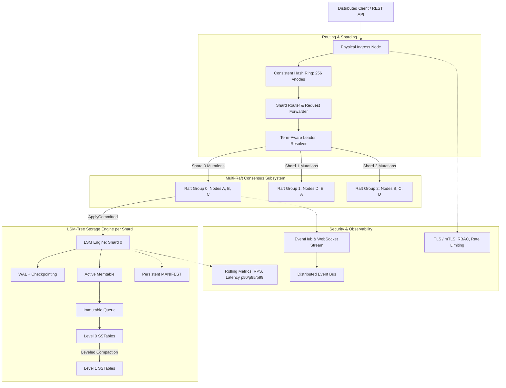

# ORBIT — Distributed Multi-Raft Key-Value Database & Storage Engine

[](https://golang.org)
[](https://nextjs.org)
[](LICENSE)
[-brightgreen.svg)](go.mod)

**ORBIT** is a high-performance, crash-resilient, distributed, sharded Key-Value database written in **pure Go** using standard library primitives exclusively.

It integrates an LSM-Tree storage engine (with Write-Ahead Logging, Memtable rotation, sparse SSTables, Bloom filters, leveled compaction, and persistent MANIFEST durability), independent **Multi-Raft consensus** groups, consistent hash ring sharding, dynamic topology membership and rebalancing, real-time RFC 6455 WebSocket cluster observability, a built-in **Benchmark CLI runner**, a **Chaos Lab fault injection framework**, and a **Next.js 14 Web Command Center** built with Switzer typography and a modern light infrastructure aesthetic (`#F4F7FC` / `#FFFFFF` / `#0891D5` / `#7965E8`).

---

## Architecture Overview



---

## Core Subsystems

### 1. LSM-Tree Storage Engine
- **Write-Ahead Log (WAL)**: Formatted with CRC32 checksums, atomic appends, sequential monotonic stamps, and disk space reclamation via `TruncateBefore(seq)`.
- **Memtables & Flushing**: Dynamic byte size tracking, automatic rotation into immutable queues, dedicated background flush worker, and writer backpressure (`maxImmutableCount`).
- **SSTable Storage**: Length-prefixed block formats, binary-searchable sparse index, and false-positive configurable Bloom filters (1% FPR) for zero-disk-read misses.
- **Leveled Compaction**: Multi-way merge compactor transitioning Level 0 tables into non-overlapping Level 1 sorted tables with automatic tombstone purging.
- **MANIFEST**: Durable atomic metadata tracking all active SSTables, levels, checksums, and flushed watermarks with crash-recovery cleanup of orphaned files.

### 2. Multi-Raft Consensus
- **Autonomous Consensus Groups**: Independent terms, logs, commit indices, and randomized election timers (150ms-300ms) per shard.
- **Batch Replication & Lag**: Configurable batching limits (`MaxBatchEntries`) and follower lag measurement (`ReplicationLag`).
- **Linearizable ReadIndex**: Serves linearizable reads from leaders without state-machine write overhead.
- **State-Machine Snapshots**: Atomic state capture, sentinel log truncation, chunked streaming `InstallSnapshot` RPC, and apply-loop synchronization.

### 3. Sharding, Dynamic Membership & Migration
- **Consistent Hash Ring**: Deterministic mapping of UTF-8 keys to shards using Murmur3 virtual nodes with minimal key movement on topology changes.
- **Dynamic Membership**: Monotonically increasing `Epoch` tracking with atomic persistence to `cluster_metadata.json` and conflict prevention.
- **Migration Coordinator**: Multi-phase replica migration (`TRANSFERRING_SNAPSHOT` $\to$ `CATCHING_UP` $\to$ `COMMITTING_PLACEMENT` $\to$ `COMPLETED`).
- **Automatic Rebalancing**: Minimizes replica moves to maintain $\max(\text{load}) - \min(\text{load}) \le 1$.

### 4. Distributed Control Plane & Web UI
- Built with **Next.js 14**, **Tailwind CSS**, and **Three.js**.
- Designed with **Switzer typography** and light infrastructure surfaces (`#F4F7FC` background, `#FFFFFF` cards, `#0891D5` cyan and `#7965E8` purple accents).
- Dedicated 11-page multi-page control center:
  - `/`: Modern landing hero with interactive 3D cluster visualization.
  - `/dashboard`: Cluster overview with real-time health cards, sparklines, and environment progress bars.
  - `/dashboard/topology`: Interactive 3D server building canvas, Bézier packet flow, and deep node inspector.
  - `/dashboard/shards`: Replica placement matrix (RF=3) and shard balance pipeline.
  - `/dashboard/raft`: Leader/follower consensus state, election timeline, and live log inspector.
  - `/dashboard/query`: Interactive KV console (GET, PUT, DELETE, Scan, Prefix scan, Batch).
  - `/dashboard/events`: Real-time WebSocket audit log with reconnection backoff and sequence deduplication.
  - `/dashboard/storage`: Real-time LSM telemetry, Memtable queue, WAL file paths, and SSTable levels.
  - `/dashboard/benchmarks`: Real workload benchmarking against the running cluster.
  - `/dashboard/chaos`: Fault injection lab with timeline tracking.
  - `/dashboard/settings`: Cluster parameter management with JSON validation and confirm modal.

---

## Cluster Orchestration Suite

A unified Python manager manages cluster lifecycle:

```bash
# Check cluster fleet status and replicas
python scripts/run_cluster.py status

# Start all 5 physical nodes
python scripts/run_cluster.py start

# Restart a specific node with zero quorum loss
python scripts/run_cluster.py restart node-a

# Tail real-time node logs
python scripts/run_cluster.py logs node-a 30

# Stop all nodes cleanly
python scripts/run_cluster.py stop
```

---

## API Reference

All endpoints support both `/` and `/api/v1/` prefixes:

| Method | Endpoint | Description |
|---|---|---|
| `GET` | `/kv/{key}` | Retrieve key value with linearizable ReadIndex |
| `PUT` | `/kv/{key}` | Store key value (`{"value": "..."}`) with quorum commit |
| `DELETE` | `/kv/{key}` | Commit tombstone deletion across shard quorum |
| `POST` | `/api/v1/kv/batch` | Atomic multi-operation batch mutation |
| `GET` | `/api/v1/kv/scan` | Range scan with cursor pagination |
| `GET` | `/api/v1/kv/prefix` | Prefix scan across key namespaces |
| `GET` | `/cluster/status` | Cluster topology overview and node list |
| `GET` | `/cluster/health` | Comprehensive shard quorums and replica health |
| `GET` | `/cluster/shards` | Configured partitions and hash ranges |
| `GET` | `/cluster/nodes` | List of all physical nodes |
| `GET` | `/cluster/nodes/{id}` | Detailed telemetry for an individual node |
| `GET` | `/cluster/raft` | Multi-Raft group summary across shards |
| `GET` | `/cluster/raft/{id}/logs` | Recent Raft log entries for consensus group |
| `GET` | `/cluster/storage` | Live LSM storage stats (Memtables, WAL, SSTables) |
| `GET` | `/cluster/storage/compaction`| Current compaction status and stats |
| `WS` | `/ws/events` | RFC 6455 WebSocket stream with monotonic sequencing |

---

## Testing & Quality Verification

Run the test suite across internal modules with the Go race detector:
```bash
go test -v -race ./internal/...
```

Run static analysis:
```bash
go vet ./...
```

Run TypeScript build check:
```bash
cd frontend && npm run build
```

Build all project binaries:
```bash
go build -o bin/orbit.exe ./cmd/orbit
go build -o bin/orbit-bench.exe ./cmd/orbit-bench
go build -o bin/orbit-chaos.exe ./cmd/orbit-chaos
go build -o bin/orbit-admin.exe ./cmd/orbit-admin
```

---

## Documentation Index

- [Architecture Guide](docs/ARCHITECTURE.md)
- [LSM Storage Engine](docs/STORAGE_ENGINE.md)
- [Multi-Raft Consensus](docs/CONSENSUS_RAFT.md)
- [Sharding & Rebalancing](docs/SHARDING_AND_REBALANCING.md)
- [HTTP API Reference](docs/API_REFERENCE.md)
- [Deployment & Operations](docs/DEPLOYMENT_AND_OPERATIONS.md)
- [Benchmarks & Chaos Lab](docs/BENCHMARKS_AND_CHAOS.md)
