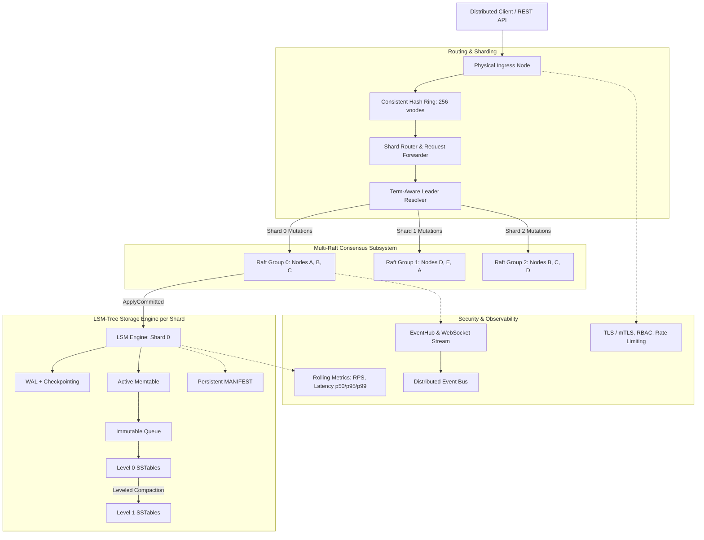

# ORBIT — Distributed Multi-Raft Key-Value Database & Storage Engine

ORBIT is a high-performance, crash-resilient, distributed, sharded Key-Value database written in **pure Go** using standard library primitives exclusively.

It integrates an LSM-Tree storage engine (with Write-Ahead Logging, Memtable rotation, SSTables, Bloom filters, leveled compaction, and MANIFEST durability), independent **Multi-Raft consensus** groups, consistent hash ring sharding, dynamic topology membership and rebalancing, real-time RFC 6455 WebSocket cluster observability, a built-in **Benchmark CLI runner**, and a **Chaos Lab fault injection framework**.

---

## Architecture Overview



---

## Core Subsystems

### 1. LSM-Tree Storage Engine
- **Write-Ahead Log (WAL)**: Formatted with CRC32 checksums, atomic appends, sequential monotonic stamps, and disk space reclamation via `TruncateBefore(seq)`.
- **Memtables & Flushing**: Dynamic byte size tracking, automatic rotation into immutable queues, dedicated background flush worker, and writer backpressure (`maxImmutableCount`).
- **SSTable Storage**: Length-prefixed block formats, binary-searchable sparse index, and false-positive configurable Bloom filters (1% FPR) for zero-disk-read misses.
- **Leveled Compaction**: Multi-way merge compactor transitioning Level 0 tables into non-overlapping Level 1 sorted tables with automatic tombstone purging.
- **MANIFEST**: Durable atomic metadata tracking all active SSTables, levels, checksums, and flushed watermarks with crash-recovery cleanup of orphaned files.

### 2. Multi-Raft Consensus
- **Autonomous Consensus Groups**: Independent terms, logs, commit indices, and randomized election timers (150ms-300ms) per shard.
- **Batch Replication & Lag**: Configurable batching limits (`MaxBatchEntries`) and follower lag measurement (`ReplicationLag`).
- **State-Machine Snapshots**: Atomic state capture, sentinel log truncation, chunked streaming `InstallSnapshot` RPC, and apply-loop synchronization.

### 3. Sharding, Dynamic Membership & Migration
- **Consistent Hash Ring**: Deterministic mapping of UTF-8 keys to shards with minimal key movement on topology changes.
- **Dynamic Membership**: Monotonically increasing `Epoch` tracking with atomic persistence to `cluster_metadata.json` and conflict prevention.
- **Migration Coordinator**: Multi-phase replica migration (`TRANSFERRING_SNAPSHOT` $\to$ `CATCHING_UP` $\to$ `COMMITTING_PLACEMENT` $\to$ `COMPLETED`).
- **Automatic Rebalancing**: Minimizes replica moves to maintain $\max(\text{load}) - \min(\text{load}) \le 1$.

### 4. Distributed API & Client Routing
- **REST Endpoints**: Versioned under `/` and `/api/v1/` for `GET`, `PUT`, `DELETE`.
- **Batch Operations**: `POST /api/v1/kv/batch` for multi-key transactional write and read operations.
- **Range Scans & Pagination**: `GET /api/v1/kv/scan` and `GET /api/v1/kv/prefix` supporting sorted cross-tier scans with `has_more` and `next_cursor`.
- **Idempotency Keys**: `X-Idempotency-Key` caching for network retry replay deduplication.
- **Transparent Forwarding**: Automatically forwards requests from follower replicas to active shard leaders.

### 5. Observability, Metrics & Events
- **Rolling Metrics Collector**: Tracks real-time RPS, reads/sec, writes/sec, latency percentiles (`p50`, `p95`, `p99`, `avg` in ms), error rates, and memory allocations via `GET /metrics` and `GET /api/v1/metrics`.
- **Monotonic Event Sequencing**: Sequence numbers and `EventsSince(seq)` buffer allowing reconnecting WebSocket clients to catch up on missed events.
- **Structured JSON Logging**: Correlated log records with correlation IDs, timestamps, and subsystem identifiers.

### 6. Security & Hardening
- **TLS & mTLS**: Production-ready server and client TLS configurations enforcing TLS 1.2/1.3 and mutual client certificate authentication.
- **Role-Based Access Control (RBAC)**: Enforces `admin`, `writer`, and `reader` privilege tiers.
- **Rate Limiting**: Token-bucket rate limiter per client IP address.
- **Request Size Limits & Origin Validation**: Enforces maximum payload body size and CORS/Origin verification.

### 7. Benchmarks (`orbit-bench`)
Configurable performance benchmarking CLI for storage engines, databases, and multi-node clusters:
```bash
go run ./cmd/orbit-bench -target storage -concurrency 8 -duration 10s -read-ratio 0.8
go run ./cmd/orbit-bench -target storage -scenario during_compaction -concurrency 4
go run ./cmd/orbit-bench -target cluster -url http://localhost:2525 -compare baseline.json
```

### 8. Chaos Lab (`orbit-chaos`)
Distributed fault injection framework testing real-world failures:
- Node failure, kill leader, kill followers, partition leader from majority.
- Network delay, packet loss, RPC timeout, and dynamic partition healing via `ChaosTransport`.
- Storage crashes during WAL append, memtable flush, compaction, SSTable corruption, and snapshot recovery.
```bash
go run ./cmd/orbit-chaos -action run -fault wal-crash -target data/node-a/wal.log
```

---

## Quickstart

### Running with Docker Compose (5 Nodes, 3 Shards)
```bash
docker compose up -d
```
Verify cluster health:
```bash
curl http://localhost:2525/live
curl http://localhost:2525/ready
curl http://localhost:2525/cluster/status
curl http://localhost:2525/metrics
```

### Running Locally from Source
```bash
# Start physical node A
go run ./cmd/orbit -config configs/node-a.json -cluster configs/cluster.json

# Perform a distributed write
curl -X PUT http://localhost:2525/api/v1/kv/user:100 \
     -H "Content-Type: application/json" \
     -d '{"value":"Alice"}'

# Read back from any physical node (e.g. node B on port 2526)
curl http://localhost:2526/api/v1/kv/user:100
```

---

## Testing & Quality Verification

Run the full test suite with the Go race detector:
```bash
go test -v -race ./...
```

Run static analysis:
```bash
go vet ./...
```

Run fuzz testing:
```bash
go test -v ./tests/ -run Fuzz
```

Build all project executables:
```bash
go build ./cmd/orbit
go build ./cmd/orbit-bench
go build ./cmd/orbit-chaos
go build ./cmd/orbit-admin
```

---

## Documentation Index

- [Architecture Guide](docs/ARCHITECTURE.md)
- [LSM Storage Engine](docs/STORAGE_ENGINE.md)
- [Multi-Raft Consensus](docs/CONSENSUS_RAFT.md)
- [Sharding & Rebalancing](docs/SHARDING_AND_REBALANCING.md)
- [HTTP API Reference](docs/API_REFERENCE.md)
- [Deployment & Operations](docs/DEPLOYMENT_AND_OPERATIONS.md)
- [Benchmarks & Chaos Lab](docs/BENCHMARKS_AND_CHAOS.md)
