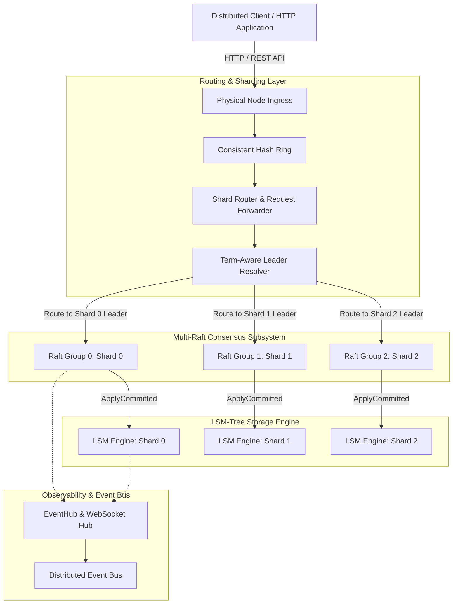
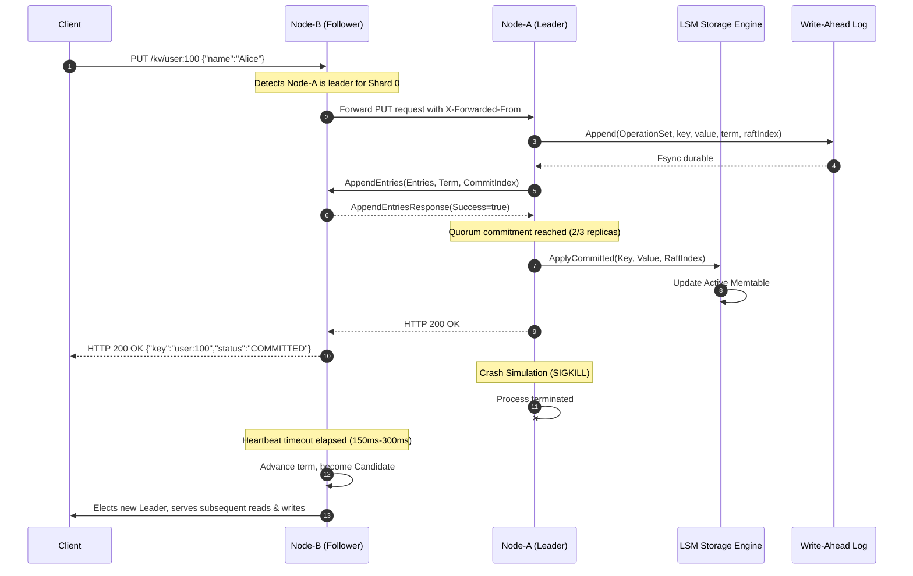

# ORBIT — System Architecture & Distributed Blueprint

ORBIT is a high-performance, distributed, linearizable, sharded Key-Value database written in **pure Go** using standard library primitives exclusively.

---

## 1. High-Level Architecture Overview

---

## 2. Core Architectural Pillars

### 2.1 Multi-Raft Partitioning
- The total keyspace is partitioned across $N$ logical shards (default: 3 shards across 5 physical nodes).
- Each shard is governed by an independent Raft consensus group ($2F+1$ replicas per group, default 3 replicas).
- A node hosts replicas for multiple shard groups concurrently without cross-group interference or lock contention.
- Independent consensus lifecycles: leader elections, log compaction, snapshot creation, and network partitions in one group do not stall unrelated groups.

### 2.2 Routing & Request Forwarding
- A consistent hash ring maps arbitrary UTF-8 keys into logical shard IDs (`murmur3`-equivalent standard hash).
- Nodes maintain term-aware leader tracking caches.
- Requests sent to a non-leader physical replica are automatically and transparently forwarded to the active shard leader with bounded retries and loop detection.

### 2.3 LSM-Tree Storage Engine
- **WAL (Write-Ahead Log)**: Sequential, CRC32 checksummed, fsynced on commit. Supports checkpointing and space reclamation (`TruncateBefore`).
- **Memtable**: Thread-safe in-memory skiplist/B-tree with byte size tracking and monotonic sequence stamps.
- **Immutable Memtables**: Rotated queue processed by background flush workers with backpressure limits (`maxImmutableCount`).
- **MANIFEST**: Durable, versioned file atomically recording all active SSTables, levels, bounds, checksums, and flushed WAL offsets.
- **Leveled Compaction**: Multi-way merge compactor transitioning Level 0 tables into non-overlapping Level 1 sorted tables with tombstone purging.
- **SSTables**: Length-prefixed block data, binary-searchable sparse index, and false-positive configurable Bloom filters for sub-millisecond point lookups.

---

## 3. Failure-Recovery Sequence

