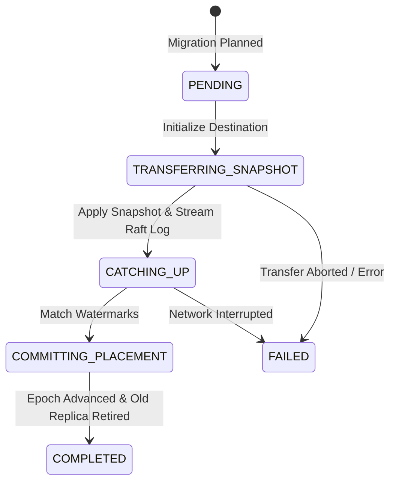

# ORBIT — Sharding, Dynamic Membership & Rebalancing

ORBIT partitions the distributed keyspace using consistent hashing combined with versioned cluster topology metadata, automatic rebalancing, and dynamic replica migration.

---

## 1. Consistent Hash Ring

- **Virtual Nodes**: Default 256 virtual nodes per shard on a $2^{32}$ integer ring.
- **Key Partitioning**: Keys are hashed deterministically. The closest shard clockwise on the ring owns the key.
- **Minimal Movement**: Adding or removing a shard moves only $\frac{1}{N}$ keys rather than rehashing the entire database.

---

## 2. Dynamic Membership & Topology Versioning

- **Cluster Epoch**: Every topology modification (node addition, node removal, shard split, or migration) increments the monotonic `Epoch`.
- **Atomic Persistence**: Topology metadata is saved atomically to `cluster_metadata.json` with an `fsync`.
- **Conflict Prevention**: Rejects stale proposed epochs (`ErrEpochRegressed`) and conflicting cluster IDs (`ErrClusterIDMismatch`).
- **Safe Node Removal**: Enforces `ErrNodeInUse` if an administrator attempts to remove a node that still hosts active shard replicas.

---

## 3. Shard Migration State Machine

Replica migration coordinates through a safe multi-phase state machine:

### Automatic Cluster Rebalancing
`CalculateRebalance(meta)` calculates the minimum replica moves to achieve balanced load distribution across all physical nodes such that:
$$\max(\text{load}) - \min(\text{load}) \le 1$$
This avoids hot spots without generating unnecessary data movement.
