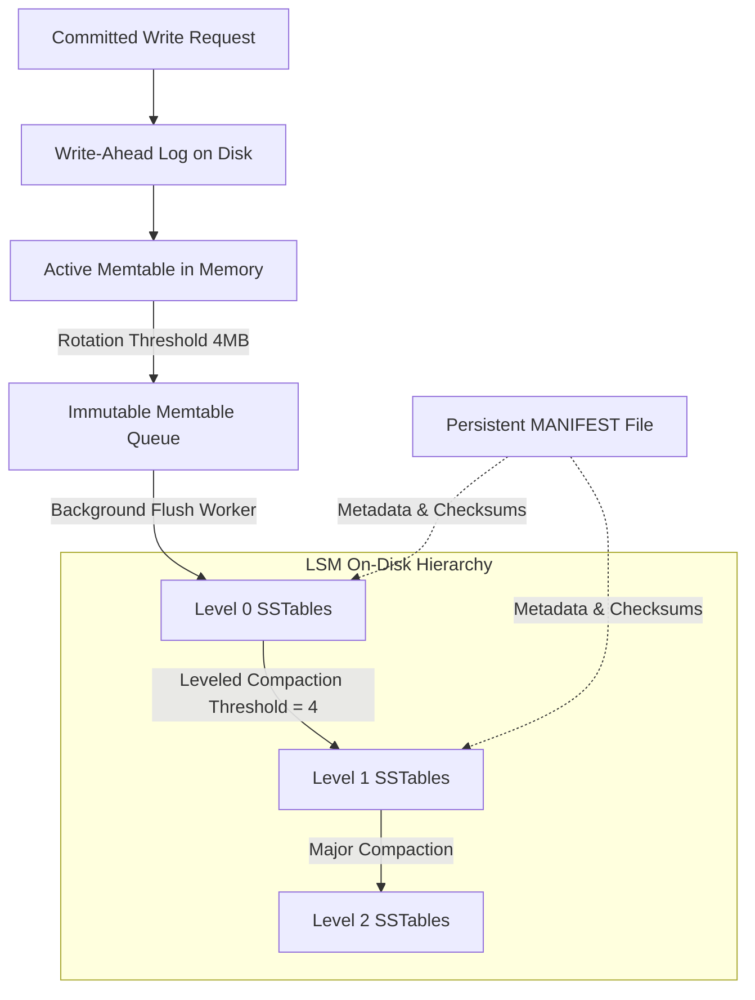

# ORBIT — LSM-Tree Storage Engine Deep-Dive

ORBIT features a custom, high-durability Log-Structured Merge-Tree (LSM-Tree) engine tailored for high write throughput, linearizable reads, and crash-resilient multi-tier persistence.

---

## 1. Storage Architecture

---

## 2. Component Specifications

### 2.1 Write-Ahead Log (WAL)
- Format: Length-prefixed records encoded with IEEE CRC32 checksums, monotonic log sequences, Raft index, and term.
- Checkpointing: Coordinates with durable SSTable flushes. Obsolete WAL files are pruned via `TruncateBefore(seq)` once all records $\le seq$ are sealed in SSTables.
- Crash Recovery: Replays valid frames sequentially and automatically detects and truncates dirty torn frames at the tail.

### 2.2 Memtable & Flush Workers
- **Active Memtable**: Tracks memory byte consumption dynamically (`SizeBytes()`). Triggers atomic rotation when `memtableSizeLimit` (default 4MB) is exceeded.
- **Backpressure**: If disk flushes stall and the immutable queue exceeds `maxImmutableCount` (default 4), incoming writes pause via condition variable `flushCond` to prevent unbounded memory growth.
- **Flush Worker**: Dedicated background goroutine draining immutable memtables sequentially into Level 0 SSTables.

### 2.3 Sorted String Tables (SSTables)
- **Header**: 8-byte magic `ORBITSST`, 4-byte format version, 4-byte level, 8-byte record count, 8-byte timestamp.
- **Data Block**: Length-prefixed key-value records with entry CRC32 checksums.
- **Sparse Index**: Binary-searchable index entries sampling keys at configurable intervals (default every 16 keys), enabling $O(\log N)$ seeks without scanning full files.
- **Bloom Filter**: False-positive configurable Bloom filter (default 1% FPR) serialized at the file tail, eliminating disk I/O for missing keys.
- **Footer**: 64-byte footer recording payload offsets, bloom filter boundaries, total file IEEE CRC32 checksum, and 8-byte footer magic `ORBITEND`.

### 2.4 Leveled Compaction
- **Minor Compaction ($L0 \to L1$)**: When Level 0 SSTables reach the threshold (default 4 tables), multi-way merge sorts all records into non-overlapping Level 1 SSTables.
- **Major Compaction**: Merges all tables across all levels, purging obsolete overwritten versions and permanently dropping tombstones once no older levels exist.
- **Crash Safety**: Compaction output is written to `.tmp` files. The `MANIFEST` is atomically replaced with a sync, ensuring readers never observe half-compacted states.
